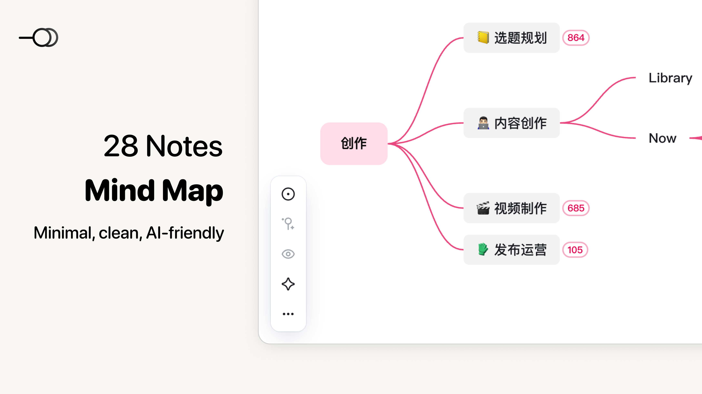
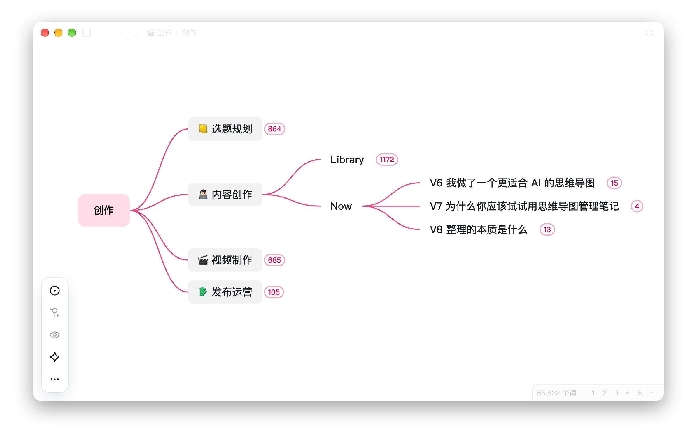
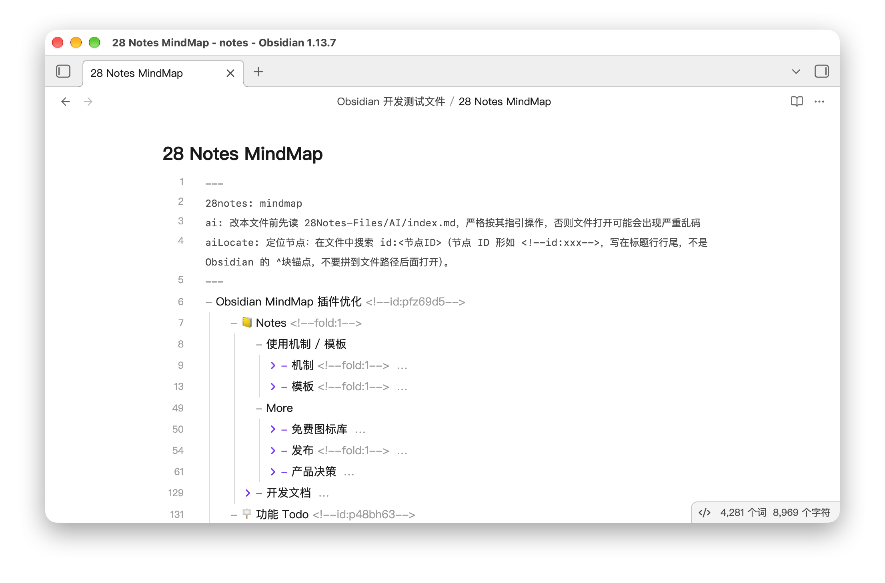
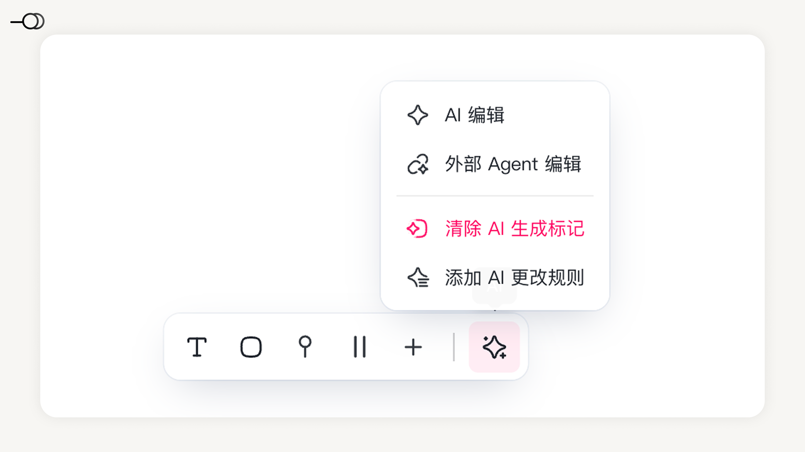
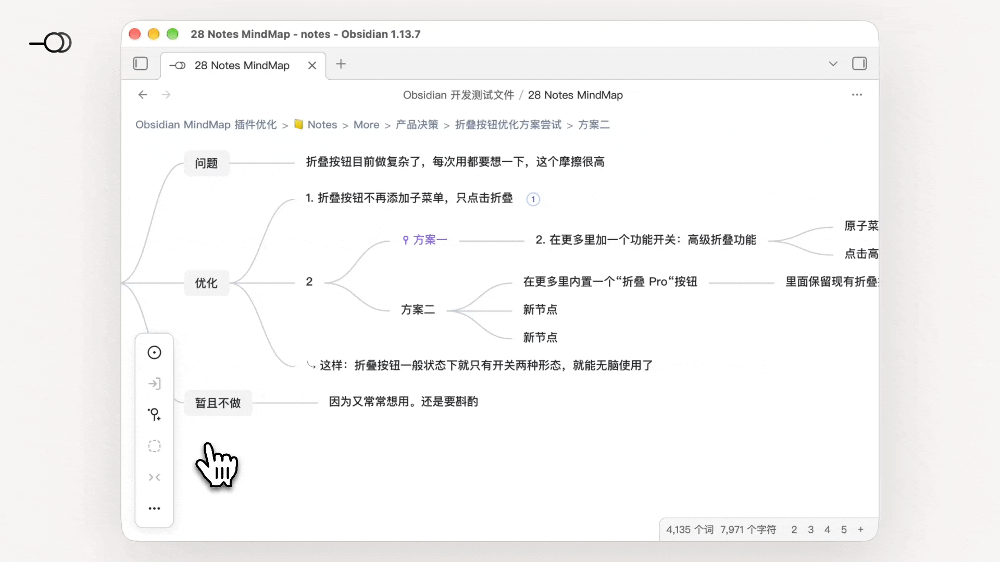
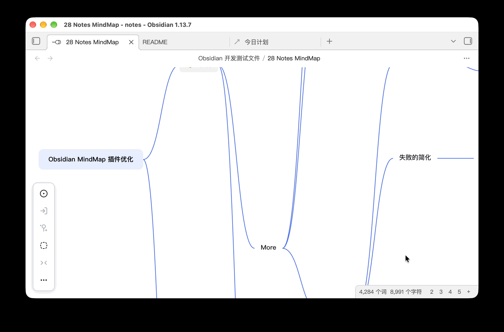
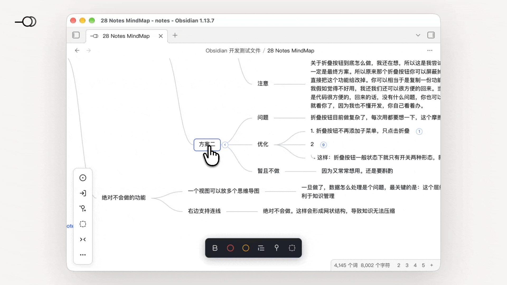
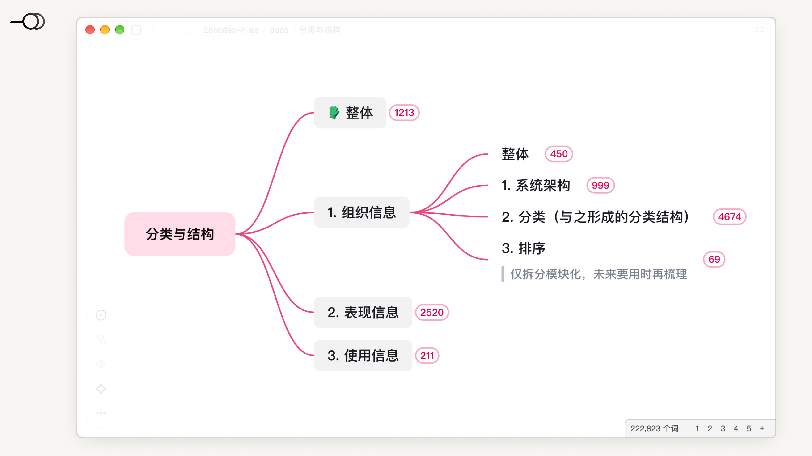
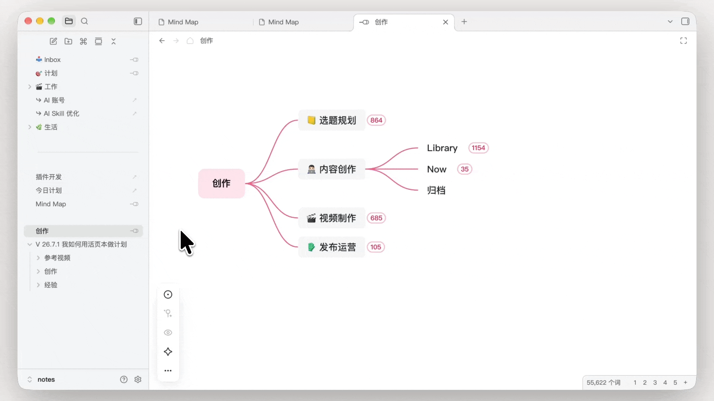

# 28 Notes MindMap

 [English Version Introduction](#english-documentation)

- 纯本地、Markdown 格式的思维导图，AI 可直接读写，修改。
- 设计理念源自「[28 笔记法](https://space.bilibili.com/481595180)」，可一键聚焦重点 / 隐藏非重点。
- 简洁，优雅，易用。

---
 

## 🧤 如何安装

1. 打开 Obsidian 桌面端，进入设置 → 第三方插件 → 社区插件
2. 搜索 **28 Notes MindMap**，安装并启用

---
 

## 🪴 Key Features

### ❶ 简洁易用

- **简洁易用**：没有复杂的功能，繁复的界面，如同白纸一般简单；操作方式对齐常规思维导图软件，让你没有任何切换成本，轻松即可上手，思维飞扬。
- **Obsidian 编辑器**：在 Obsidian 中央编辑器直接编辑，无需另开渲染窗口，所见即所得。

*图注：简单、干净的使用体验*

 

### ❷ AI 友好

大多数思维导图软件，把数据存在私有格式里，
导致 AI Agent 工具难以直接阅读和更改。

而 28 Notes MindMap 从设计之初，就为了 AI 易用：

- **纯 Markdown 存储**：你的导图就是一个普通 `.md` 本地文件，内容是纯粹的大纲形式。关掉插件、甚至不用 Obsidian，用任何文本编辑器都能读写。
- **为 Agent 编辑设计**：支持 Agent 定位到指定节点树编辑；支持在思维导图内添加 AI 编辑规则，约束 AI 更改；AI 更改后会自动添加 AI 标记，便于区分。
- **预埋 AI 指令**：内置 AI 编辑规则，AI 编辑时会自动遵循。你只需专注需求，而无需关心格式。

*图注：28 Notes MindMap 源文件：Markdown 大纲格式*

*图注： AI 更改的内容会自动标记，你也可手动添加 AI 更改规则*

 

### ❸ 聚焦重点

思维导图最大的痛点就是节点变多后，
一打开密密麻麻，难以使用。

28 Notes MindMap 设计了大量的创新模式，以解决这个问题：

- **关注点分离功能**：支持将节点标记为当前关注 / 次要节点，并一键只显示当前关注节点 / 隐藏次要节点，瞬间聚焦重点。
- **下钻与捷径功能**：支持一键下钻进某个节点树，聚焦单树。并能将此下钻视图存为捷径，下次打开直接进入。上次思维漫游到哪里，这次直接看哪里。
- **按层级折叠功能**：支持一键折叠 / 打开至某一层级。瞬间从迷失到清晰。

*图注：「一键只显示重点」功能演示*

*图注：「一键折叠至第二层级」功能演示*

*图注：「进入节点」功能演示*

 

### ❹ 为知识管理设计

思维导图通常用于学习和思维扩展，
而 28 Notes Mind Map 在此之上，专门针对知识管理做了焕然一新的创新。

- **基础功能**：高度集成 Obsidian；性能专门优化，20 万字超大型思维导图加载仅需 2S；支持创新的文档管理功能，让思维导图嵌入传统文档管理流程中。
- **基于知识管理的结构设计**：基于知识从混乱到结构化的过程，设计严格树状层级结构；不含连线、概要等功能，有利于知识压缩，也避免结构交织混乱，使得思维导图可以扩展到数十万量级。
- **支持 inl 结构**：你可以将一个领域的笔记 / 文件全部存到一个思维导图里，并生成临时使用捷径。使用上，形成 Library 和 Now 注意力分离机制；管理上，让知识的存放和使用归为一处，形成最佳管理状态。

*图注：管理 22W 字，1W+ 节点的超大知识体系，仍能保持简单清晰*

*图注：将文档转入思维导图管理*

---
 

## 🚀 快速开始

### 创建你的第一张导图

- 点击左侧功能区的“28 Notes”图标即可。
- 你也可以打开命令面板，搜索 28，用命令/快捷键，快速新建。

### 基础快捷键

| 操作                    | 默认快捷键                              |
| --------------------- | ---------------------------------- |
| 新建子节点 *               | `Tab`*                             |
| 新建同级节点 *              | `Return`*                          |
| 在上方新建同级节点             | \                                  |
| 在上一层新建同级节点            | \                                  |
| 新建子文档                 | \                                  |
| 删除节点 *                | `Delete`*                          |
| 加粗节点                  | `Cmd + B`                          |
| 节点备注                  | `Shift + Return`                   |
| 光标插入节点开始              | \                                  |
| 光标插入节点末尾              | \                                  |
| 撤销 / 重做 *             | `Cmd + Z` / `Shift + Cmd + Z`*     |
| 复制 / 剪切 / 粘贴节点 *      | `Cmd + C` / `Cmd + X` / `Cmd + V`* |
| 复制为纯文本（去掉格式与 AI 标记） * | `Option + Cmd + C`*                |
| 粘贴剪贴板内容 *             | `Option + Cmd + V`*                |
| 复制节点链接                | \                                  |
| 将选中节点标为红色             | `Cmd + R`                          |
| 将选中节点标为黄色             | `Cmd + Y`                          |
| （不）设为 Now 当前节点        | `Cmd + N`                          |
| （不）设为 Minor 次要节点      | `Cmd + M`                          |
| （不）设为待办 Todo 节点       | `Cmd + L`                          |
| （不）设为完成 Done 节点       | \                                  |
| 选择上一个节点 *             | `↑`*                               |
| 选择下一个节点 *             | `↓`*                               |
| 选择母节点 *               | `←`*                               |
| 选择子节点 *               | `→`*                               |
| 全选当前可见的全部节点 *         | `Cmd + A`*                         |
| 定位循环                  | \                                  |
| 搜索节点 *                | `Cmd + F`*                         |
| （只）显示 Now 当前节点        | \                                  |
| 显示/隐藏 Minor 次要节点      | \                                  |
| 进入当前节点                | \                                  |
| 建立捷径                  | \                                  |
| 复制 AI 定位路径            | \                                  |
| 添加 AI 生成标记            | \                                  |
| 添加 AI 更改规则            | \                                  |
| 预览图片 / 按住不放可拖动画布 *    | `Space`*                           |
| 关闭预览 / 退出全屏 *         | `Esc`*                             |
| 全屏专注模式（仅在窗口内）         | \                                  |
| 全屏专注模式（桌面全屏）          | \                                  |
| 新建思维导图（28 Notes）      | \                                  |
| 切换源文件 / 思维导图视图        | \                                  |

> 注：`Cmd` 在 Windows 平台为 `Ctrl`，`Option` 为 `Alt`；
> 	标 * 快捷键不可自定义，其它均可自定义；
> 	\ 指：默认无快捷键，但可自定义。

---
 

## 💰 试用与付费

### 14 天免费试用

安装后自动开始 14 天全功能试用，无任何功能限制。

### 试用结束后

我们采用特别的付费方案：

- **市面上思维导图软件存在的大多数功能：无限制使用**
- 如：无限量生成思维导图、插入图片、备注、Obsidian 双链、本地文件链接、节点链接等。

- **28 Notes 原创的创新功能：试用期结束后，需激活以使用**
- 如：Now、Minor、捷径、AI定位路径、多级折叠等。

**具体如下：**

| 功能                      | 通用免费版 | 创新 Pro 版 |
| ----------------------- | ----- | -------- |
| 无限制生成思维导图               | ✅     | ✅        |
| 思维导图通用编辑（增删节点、拖拽、撤销重做等） | ✅     | ✅        |
| 进入某节点/面包屑导航             | ✅     | ✅        |
| 双链/文件链接/节点链接            | ✅     | ✅        |
| 备注                      | ✅     | ✅        |
| 多主题                     | ✅     | ✅        |
| 历史版本快照                  | ✅     | ✅        |
| 界面简化                    | ✅     | ✅        |
| Now / Minor 节点          | ❌     | ✅        |
| 捷径                      | ❌     | ✅        |
| 高级折叠（按层折叠）              | ❌     | ✅        |
| 用文档管理思维导图               | ❌     | ✅        |
| 添加 AI 更改规则 / 添加 AI 生成标记 | ❌     | ✅        |

### 价格

- **早鸟价 ¥48**（~~原价 ¥96~~ → -50%）
- 买断制：一次购买，永久使用本地功能
- 支持 **3 台设备**激活
- 付款与激活方式：下载插件后，见：Obsidian → 设置 → 28 Notes → 许可证

> 注：买断覆盖本地全部功能。但不包含未来可能上线的在线式 AI 生成服务 / 涉及服务器的功能

---
 

## ❓ 常见问题

### 我的数据会被上传吗？

不会。28 Notes 完全本地运行，不收集数据、不调用任何外部 API。

### 和其他思维导图软件/插件有什么区别？

- **其它思维导图软件 / 插件**：私有格式，AI 无法直接编辑；功能趋同。
- **28 Notes**：Markdown 格式，适合 AI Agent 操作；大量创新功能。

### 支持移动端吗？

目前仅桌面端。移动端暂无明确时间表。

### 激活码可以换电脑吗？

可以。一个码支持 3 个设备同时激活。
换电脑时在旧设备解除激活，即可在新设备上使用。

### 我可以用 AI 直接编辑导图文件吗？

可以！这正是 28 Notes 的设计目标。

你只要点击底部 AI 按钮，输入需求并给到 AI Agent，它就能精确定位和编辑。插件内置格式规则，你只需要专注需求，而无需考虑任何格式问题。

---

 

## 📄 许可

本插件代码仅供 Obsidian 审核和社区核查，不得二次分发或用于商业转售。详见 License。

---

*28 Notes MindMap — 极简，无混乱，AI 友好*

---

## English Documentation

# 28 Notes MindMap

- Markdown-based mind maps that AI can read, write, and edit directly.
- Design inspired by the "[28 Notes Method](https://space.bilibili.com/481595180)", with one-click focus on key points / hiding of non-essentials.
- Simple, elegant, and easy to use.

---

## 🧤 Installation

1. Open Obsidian desktop, go to Settings → Third-party plugins → Community plugins.
2. Search for **28 Notes MindMap**, install and enable it.

---

## 🪴 Key Features

### ❶ Simple & Easy to Use

- **Simple & easy to use**: No complex features or cluttered UI — as plain as a blank sheet of paper. The interaction aligns with conventional mind-map software, so you can pick it up with zero switching cost and let your thoughts flow.
- **Obsidian editor**: Edit directly in Obsidian's central editor, no separate render window needed — what you see is what you get.

*Caption: A simple and clean user experience*

### ❷ AI-Friendly

Most mind-map software stores data in proprietary formats, making it hard for AI Agent tools to read or modify directly.

28 Notes MindMap was designed from the ground up to be AI-friendly:

- **Pure Markdown storage**: Your map is just a plain local `.md` file in outline form. Close the plugin, or even skip Obsidian entirely — any text editor can read it.
- **Built for Agent editing**: An Agent can target a specific node tree and edit just that one; you can add AI editing rules inside the map to constrain the AI; AI-made changes are marked automatically, so you can tell them apart at a glance.
- **AI instructions built in**: The built-in AI editing rules are followed automatically whenever an AI edits. You only focus on your needs, never on the format.

*Caption: 28 Notes MindMap source file — Markdown outline format*

*Caption: AI-made changes are marked automatically; you can also add AI editing rules by hand*

### ❸ Focus on What Matters

The biggest pain point of mind maps is that once nodes grow, opening one feels overwhelming and unusable.

28 Notes MindMap introduces many innovative modes to solve this:

- **Focus separation**: Mark the node you're focused on as Now and secondary nodes as Minor, then show only Now / hide Minor with one click — instantly zero in on what matters.
- **Drill in & shortcuts**: Drill into a node tree with one click to focus on that single tree, and save that view as a shortcut to reopen it directly next time — pick up exactly where your mind left off.
- **Fold by level**: Fold / unfold to any level with one click — instantly go from lost to clear.

*Caption: "Show only what matters" demo*

*Caption: "Fold to level 2" demo*

*Caption: "Enter node" demo*

### ❹ Optimized for Knowledge Management

Mind maps are usually used for learning and expanding thoughts. On top of that, 28 Notes Mind Map brings a fresh set of innovations built specifically for knowledge management.

- **Core features**: Deeply integrated with Obsidian; performance specifically optimized — a 200,000-character map loads in about 2 seconds; innovative document management lets mind maps fit into a conventional document workflow.
- **A structure designed for knowledge management**: Built around the path from messy to structured knowledge — a strict tree hierarchy, with no connectors or summary frames. That keeps knowledge compressed and avoids structural entanglement, so a map can scale to hundreds of thousands of nodes.
- **Supports the "inl" structure**: Store all the notes / files of one domain in a single mind map, and spin off a temporary shortcut for daily use. In use, this gives you a Library / Now separation of attention; in management, knowledge is stored and used in one place — the best possible state.

*Caption: Managing 222k words and 10k+ nodes — still simple and clear*

*Caption: Manage documents inside a mind map*

---

## 🚀 Quick Start

### Create your first map

- Click the "28 Notes" icon in the left ribbon.
- Or open the command palette, search "28", and use the command / hotkey to create one quickly.

### Basic shortcuts

| Action | Default shortcut |
|-|-|
| Add child node * | `Tab`* |
| Add sibling node * | `Return`* |
| Add sibling above | \ |
| Add sibling one level up | \ |
| Add child document | \ |
| Delete node * | `Delete`* |
| Bold node | `Cmd + B` |
| Node note | `Shift + Return` |
| Move caret to node start | \ |
| Move caret to node end | \ |
| Undo / redo * | `Cmd + Z` / `Shift + Cmd + Z`* |
| Copy / cut / paste nodes * | `Cmd + C` / `Cmd + X` / `Cmd + V`* |
| Copy as plain text (drops formatting and AI marks) * | `Option + Cmd + C`* |
| Paste clipboard content * | `Option + Cmd + V`* |
| Copy node link | \ |
| Mark selected node red | `Cmd + R` |
| Mark selected node yellow | `Cmd + Y` |
| (Un)set Now | `Cmd + N` |
| (Un)set Minor | `Cmd + M` |
| (Un)set To-Do | `Cmd + L` |
| (Un)set as Done | \ |
| Select previous node * | `↑`* |
| Select next node * | `↓`* |
| Select parent node * | `←`* |
| Select child node * | `→`* |
| Select all visible nodes * | `Cmd + A`* |
| Locate cycle | \ |
| Search nodes * | `Cmd + F`* |
| Show only Now nodes | \ |
| Show / hide Minor nodes | \ |
| Enter current node | \ |
| Create Shortcut | \ |
| Copy AI locate path | \ |
| Add AI-generated mark | \ |
| Add AI rules | \ |
| Preview image / hold to pan the canvas * | `Space`* |
| Close preview / exit full screen * | `Esc`* |
| Full-screen focus (window only) | \ |
| Full-screen focus (desktop full-screen) | \ |
| New mind map (28 Notes) | \ |
| Toggle source / mind-map view | \ |

> Note: `Cmd` is `Ctrl` on Windows, `Option` is `Alt`;
> 	keys marked * are not customizable, all others are;
> 	`\` means no default shortcut, but you can set one.

---

## 💰 Trial & Pricing

### 14-day free trial

A full-feature 14-day trial starts automatically after install, with no limitations.

### After the trial

We use a special pricing model:

- **Most features found in mainstream mind-map software: unlimited**
  - e.g. unlimited map generation, images, notes, Obsidian links, local file links, node links, etc.
- **28 Notes' original innovations: require activation after the trial**
  - e.g. Now, Minor, shortcuts, AI location path, multi-level folding, etc.

Details:

| Feature | Free | Pro |
|---|---|---|
| Unlimited map generation | ✅ | ✅ |
| General editing (add/delete nodes, drag, undo/redo…) | ✅ | ✅ |
| Enter node / breadcrumb nav | ✅ | ✅ |
| Bidirectional / file / node links | ✅ | ✅ |
| Notes | ✅ | ✅ |
| Multiple themes | ✅ | ✅ |
| History snapshots | ✅ | ✅ |
| UI simplification | ✅ | ✅ |
| Now node | ❌ | ✅ |
| Minor node | ❌ | ✅ |
| Save as shortcut | ❌ | ✅ |
| Copy AI location path | ❌ | ✅ |
| Advanced folding (by level) | ❌ | ✅ |

### Pricing

- **Early-bird price ¥48** (~~original ¥96~~ → -50%)
- One-time purchase: buy once, use local features forever
- Supports activation on **3 devices**
- Payment & activation: after installing the plugin, see Obsidian → Settings → 28 Notes → License

> Note: The one-time purchase covers all local features, but excludes possible future online AI-generation services / server-dependent features (noted for clarity only; such features are unlikely, since current AI Agents are already simple and easy to use).

---

## ❓ FAQ

### Will my data be uploaded?

No. 28 Notes runs fully locally — no data collection, no external API calls.

### How is it different from other mind-map software / plugins?

- **Other mind-map software / plugins**: proprietary formats that AI cannot edit directly; features converge.
- **28 Notes**: Markdown format, suited for AI Agents; packed with original features.

### Mobile support?

Desktop only for now. Mobile may come, but there is no fixed timeline.

### Can the activation code move to another computer?

Yes. One code activates up to 3 devices at the same time. Deactivate on the old device to use it on the new one.

### Can I let AI edit the map file directly?

Yes! That's exactly the design goal. Select a node, right-click "Copy AI location path", hand it to the Agent, and it can pinpoint and edit precisely. You don't even need to tell the AI what format to follow or add any Skill wrapper — 28 Notes has already taken care of it.

---

## 🗺️ Roadmap

- [ ] Advanced Obsidian link features
- [ ] AI skills optimization

---

## 📄 License

The plugin code is for Obsidian review and community verification only; redistribution or commercial resale is prohibited. See License for details.

---

*28 Notes MindMap — Minimal, no clutter, AI-friendly*
